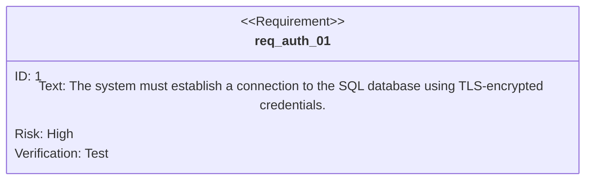
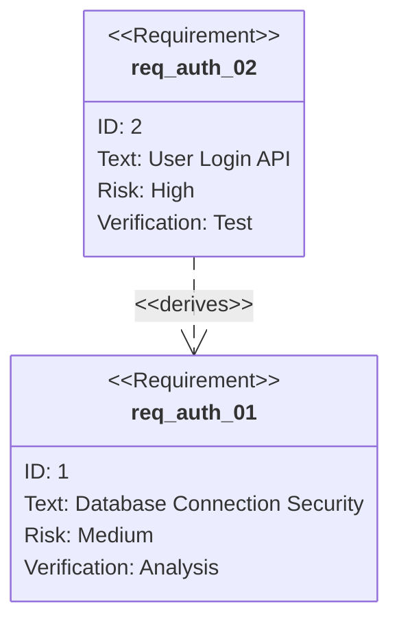
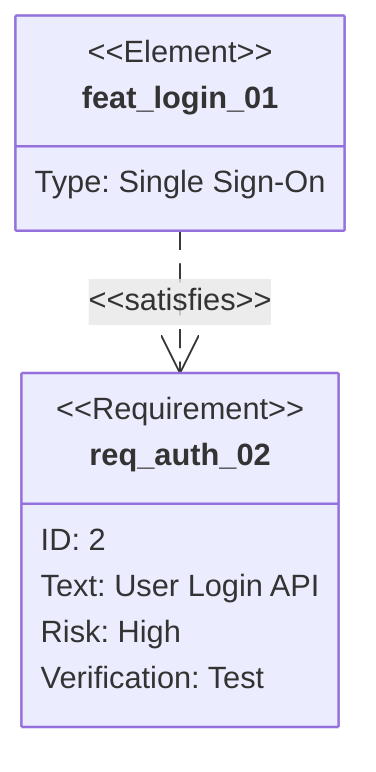
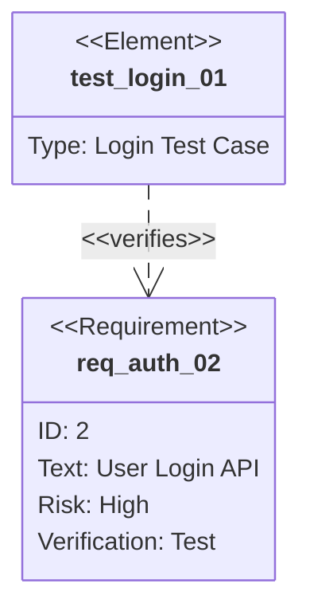
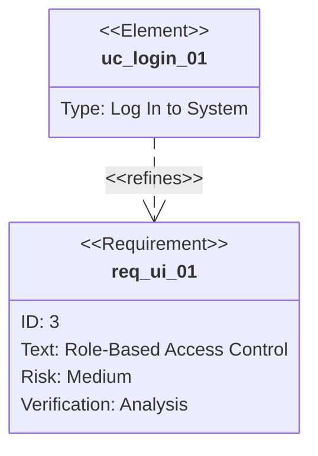
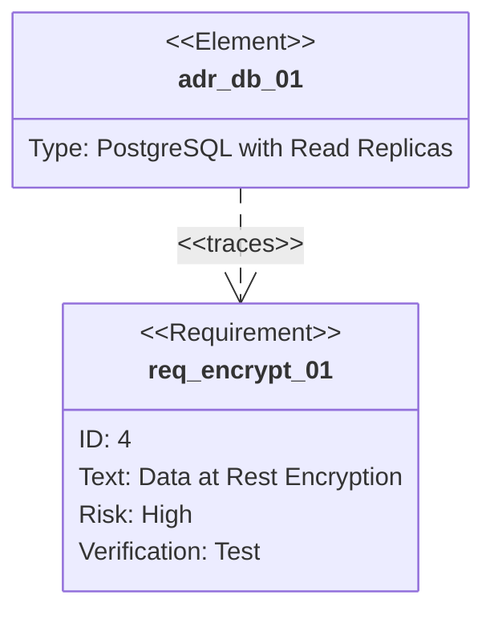
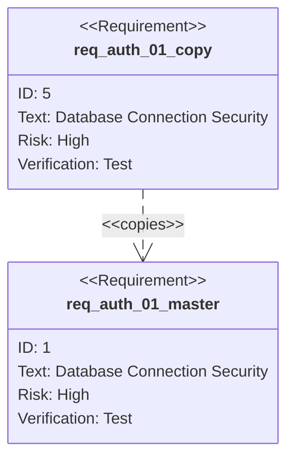

# SysML® Requirement Diagram — Standard Reference

> Based on the OMG SysML® v1.6 (formal/2019-11-01) and SysML v2.0 (formal/2025-09-01) specifications

> This note summarises the standard itself. durable-cache's requirement model takes inspiration from SysML requirement diagrams without following them strictly (see "The Refinement Model" in the Introduction of `docs/durable-cache.pdf`); the req-checking skill (`.claude/skills/req-checking/`) borrows its direction and typing rules from it.

## 1. Purpose of the Requirement Diagram

A **requirement diagram** (reqd) is one of the nine SysML diagram types. It models text-based requirements as first-class model elements, captures their hierarchical decomposition, and relates them to other model elements (blocks, test cases, use cases, activities, etc.) to provide full traceability across the system model.

Req diagrams are a specialisation of the UML® class diagram. Every element on a reqd is a stereotype applied to a UML `Class`, `Dependency`, or `Usage`.

---

## 2. Requirement Node (`«requirement»`)

In the **SysML v1.6** specification, the base element is the `«requirement»` stereotyped class. The `Requirement` metaclass extends `Class` and owns two mandatory string properties:

| Property | Type   | Description                      |
|----------|--------|----------------------------------|
| `id`     | String | Globally unique identifier       |
| `text`   | String | The textual requirement statement |

A requirement node is normally rendered with three compartments (stereotype, name/id, text).



In the **SysML v2.0** specification, the notation uses a textual syntax with the keyword `requirement`:

```
requirement REQ_AUTH_01 {
    doc /* The system must establish … */
}
```

Additional compartments for risk, status, source, etc. are user-defined extensions and not part of the base specification.

---

## 3. Standard Requirement Subtypes (SysML v2 library)

The SysML v2.0 specification defines a standard library of requirement specialisations. Each inherits `id`, `text`, and the relationship framework from the base `requirement` definition:

| Subtype                  | Keyword                    | Purpose                                               |
|--------------------------|----------------------------|-------------------------------------------------------|
| Base requirement         | `requirement`              | Any textual statement of needed capability or constraint |
| Functional requirement   | `functionalRequirement`    | Describes a function the system must perform          |
| Interface requirement    | `interfaceRequirement`     | Specifies interactions between system entities        |
| Performance requirement  | `performanceRequirement`   | Quantified measure of effectiveness or efficiency     |
| Physical/Structural req. | `structuralRequirement`    | Physical characteristic or constraint on the system   |
| Design constraint        | `designConstraint`         | Limitation on design freedom (e.g. "must use COTS")   |
| Use case                 | `useCase`                  | Behavioural scenario expressing a stakeholder goal    |
| Stakeholder requirement  | `stakeholderRequirement`   | Need or expectation expressed by a stakeholder        |

*Note:* the SysML v1.6 specification does **not** define these subtypes; all requirements use a single `«requirement»` stereotype. The subtype list above reflects the richer type system introduced in the standard model library of the SysML v2.0 specification.

---

## 4. Standard Relationships

The SysML specifications define six standard dependency types that connect requirements to each other and to other model elements:

| Stereotype        | Line Style        | Arrowhead        | Direction                   |
|-------------------|-------------------|------------------|-----------------------------|
| `«deriveReqt»`    | Dashed            | Open (empty)     | Derived → Source            |
| `«satisfy»`       | Solid             | Open (empty)     | Element → Requirement       |
| `«verify»`        | Solid             | Open (empty)     | Test case → Requirement     |
| `«refine»`        | Dashed            | Open (empty)     | Element → Requirement       |
| `«trace»`         | Dashed            | Open (empty)     | Any → Any                   |
| `«copy»`          | Dashed            | Open (empty)     | Copy → Master               |

### 4.1 `«deriveReqt»`

**Semantics:** The source requirement is the origin from which the derived requirement is obtained. The derived requirement typically adds detail or constrains the source. Used for requirement decomposition.



### 4.2 `«satisfy»`

**Semantics:** The source model element satisfies, implements, or realises the target requirement. Primary link for design-to-requirements traceability.



### 4.3 `«verify»`

**Semantics:** The source test case validates that the target requirement has been correctly satisfied.



### 4.4 `«refine»`

**Semantics:** The source element refines, clarifies, or elaborates the meaning of the target requirement. Does **not** imply a derivation hierarchy.



### 4.5 `«trace»`

**Semantics:** General-purpose dependency when no other stereotype applies. Commonly used for linking architecture decisions, rationale, or trade studies to requirements.



### 4.6 `«copy»`

**Semantics:** The source requirement is an exact textual copy of the master. Updates to the master propagate to the copy.



---

## 5. Requirement Containment

Req diagrams also show **containment** (composition) between requirements:

- A high-level requirement can **contain** sub-requirements via the standard UML composite association (filled diamond).
- Contained requirements inherit the context of the parent and are typically constrained to refine or derive from it.
- Containment is distinct from `«deriveReqt»`: contained requirements are structural children; derived requirements have a semantic dependency.

Mermaid's requirement diagram syntax does not directly support containment arrows. In SysML notation this is rendered as a standard UML composition (filled diamond on the parent side).

---

## 6. Requirement Tables

In addition to the graphical diagram, the SysML specifications provide tabular representations of requirements:

- **Requirement table** — rows represent requirements; columns show properties (id, text, status, etc.).
- **Relationship table** — rows show source elements; columns show relationship type and target.
- Tables can be dynamically derived from the model and are useful for review, gap analysis, and verification traceability.

These tables are not a separate diagram type, but a view that may appear on any diagram or document.

---

## 7. Conformance Notes

- The `«requirement»` stereotype and all six relationship stereotypes are mandatory for any tool claiming SysML v1.6 conformance.
- Requirement subtypes beyond the base `«requirement»` are optional in v1.6 (user-defined via profiling) but part of the mandatory standard library in the SysML v2.0 specification.
- The `id` and `text` properties are mandatory on every requirement. All other compartments (status, risk, priority, etc.) are user extensions.
- Cross-relationship rules:
  - `«satisfy»`, `«verify»`, `«refine»`, and `«trace»` have a **requirement** as their target.
  - `«deriveReqt»` has a **requirement** as both source and target.
  - `«copy»` has a **requirement** as both source and target.
  - The source of `«satisfy»` must **not** be another requirement (it must be a design/implementation element). All other stereotypes permit any model element as source.

---

## References

1. OMG SysML v1.6, formal/2019-11-01, §16 (Requirements Model Library)
2. OMG SysML v2.0, formal/2025-09-01, §8 (Requirement Definition) and §10 (Standard Library)
3. OMG Systems Modeling API and Services v2.0, formal/2025-09-01

---

OMG SysML, SysML and UML are registered trademarks of Object Management Group, Inc. in the United States and/or other countries.
